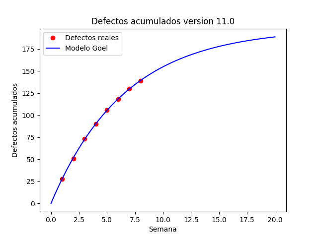

# parcial DS II - HuilaSoft

integrantes:
- Cristian Gerardo Dussan Losada - 20171157265
- Andrade - codigo

Escogimos la **opcion B** (CampanaPruebas), la de los defectos de la version 11.0.

## Parte 1 - MongoDB

La base se llama `huilasoft` y tiene tres colecciones.

`agentes`: codigo (string), nombre (string), nivel (string), tickets_hora (int), de_turno (boolean)

`tickets`: codigo (string), llegada_min (int), atencion_min (int), prioridad (string), agente_codigo (string)

`defectos_semanales`: version (string), semana (int), defectos (int)

Los tickets se relacionan con los agentes por el campo `agente_codigo`, que guarda el codigo del agente que lo atendio. En mañana solo estaba Laura, todos los tickets tienen AG01. Un agente puede tener muchos tickets. La de defectos no se relaciona con las otras dos.

Todo lo que corrimos en mongosh esta en la carpeta `mongo`

## Parte 2 - Clase en Python

Usamos el modelo de Goel-Okumoto, que trabaja con los defectos acumulados:

m(t) = a(1 - e^(-bt))

a es cuantos defectos tiene el software en total y b que tan rapido los vamos encontrando.

En `modelo.py` esta la clase. El constructor recibe los defectos de cada semana y los va sumando (28, 51, 73... hasta 139). Despues `ajustar()` saca a y b con curve_fit, `restantes()` dice cuantos faltan por encontrar y `graficar()` hace la grafica. `main.py` lee los datos de mongo y ejecuta todo.

Las pruebas estan en `tests/test_modelo.py`: una revisa que goel(0, a, b) de 0 y la otra que si queden defectos por encontrar.

Para correrlo:

```
pip install -r requirements.txt
python src/main.py
python tests/test_modelo.py
```

Lo que nos dio:
- a = 198.06
- b = 0.1519
- defectos sin descubrir: 58.8
- semana del 95%: 19.7



## Parte 3 - Interpretacion

En 8 semanas de pruebas se encontraron 139 defectos, pero segun el modelo la version 11.0 tiene unos 198 en total, entonces si se libera hoy quedarian mas o menos 59 defectos sin revisar. En la grafica se ve que los puntos reales quedan casi pegados a la curva, o sea que el modelo se ajusta bien, y tambien que la curva todavia va subiendo en la semana 8 y no se ha aplanado lo que quiere decir que se siguen encontrando errores. Con t = ln 20 / b nos dio que el 95% de los defectos se encontraria en la semana 19.7, faltarian como 12 semanas mas de pruebas. 

Le recomendamos a HuilaSoft no sacar todavia la version 11.0 y seguir probando por lo menos hasta la semana 20.
